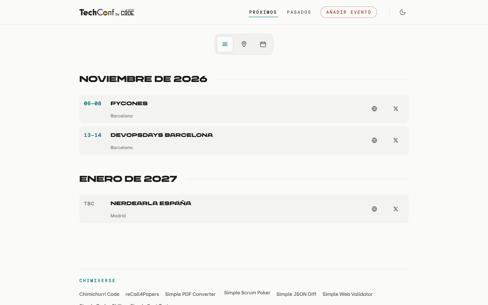
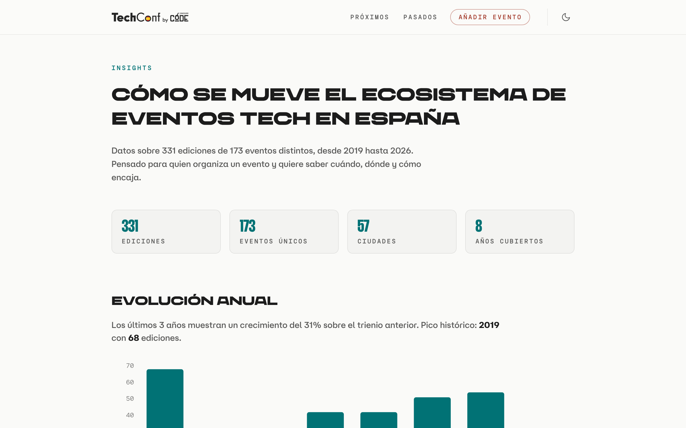
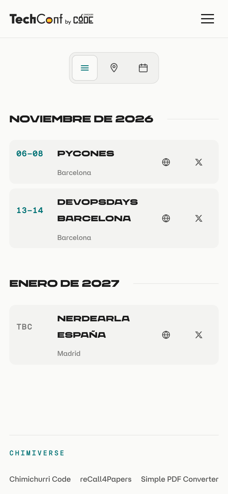

# tech-conferences-spain

[](https://github.com/npatarino/tech-conferences-spain/actions/workflows/ci.yml)

A community-curated list of software development conferences held in Spain — past, present, and upcoming. Every edition is a small Markdown file in this repo; the site is rebuilt from them.

**Live site:** [techconf.es](https://techconf.es)

<p align="center">
  
</p>

---

## Features

The site (in Spanish) is generated from `content/conferences/` and renders:

- **Upcoming events** (`/`) grouped by month, with links to the website, Twitter/X, Bluesky and CFP
- **Past events** archive (`/past`)
- **Calendar** view (`/calendar`)
- **Map** view (`/map`, Google Maps — needs an API key, see [Environment variables](#environment-variables))
- **Insights** (`/insights`): yearly evolution, city breakdown and other trends across all editions
- Cancelled editions are shown struck through; editions with unconfirmed dates show `TBC`
- SEO out of the box: sitemap, JSON-LD, Open Graph image, web manifest
- **Open data**: every edition is also published as an [OpenTechEvents](https://opentechevents.org) feed (`/events.json`) and an iCalendar file (`/events.ics`) — see [Open data feed](#open-data-feed-opentechevents)

<p align="center">
  
  
</p>

---

## Adding a conference

This is the main way to contribute: add or edit one Markdown file and open a pull request.

### 1. Find (or create) the event directory

Conferences are grouped by recurring event, not by year. Each event lives in its own folder:

```
content/conferences/
├── t3chfest-madrid/
│   ├── t3chfest-madrid-2024.md
│   ├── t3chfest-madrid-2025.md
│   └── t3chfest-madrid-2026.md
├── devbcn-barcelona/
│   ├── devbcn-barcelona-2024.md
│   └── devbcn-barcelona-2025.md
└── coolconf-valencia/        ← new event → new folder
    └── coolconf-valencia-2026.md
```

**Folder naming:** `event-name-city/` — lowercase, hyphen-separated.

**File naming:** `event-name-city-YYYY.md` — same slug as the folder, plus the year. The file name (without `.md`) is the edition's ID, so it must be unique across all folders.

Only `.md` files one level inside a folder of `content/conferences/` are loaded.

### 2. Create the conference file

Copy this, then delete the optional lines you don't need:

```yaml
---
name: "CoolConf"
website: https://coolconf.es/2026/
twitter: https://x.com/coolconf
bluesky: https://bsky.app/profile/coolconf.bsky.social
location: Valencia, Spain

date_start: 2026-10-15
date_end:   2026-10-16

cfp_start: 2026-05-01
cfp_end:   2026-07-31
cfp_site:  https://coolconf.es/2026/call-for-papers
---
```

Real example: [`content/conferences/t3chfest-madrid/t3chfest-madrid-2026.md`](content/conferences/t3chfest-madrid/t3chfest-madrid-2026.md).

### Field reference

| Field | Required | Description |
|---|---|---|
| `name` | Yes | Display name of the conference. Do not include city or year — the city comes from `location`. |
| `website` | Yes | Full URL to the edition's homepage. |
| `twitter` | No | Twitter/X profile of the event. |
| `bluesky` | No | Bluesky profile URL of the event (`https://bsky.app/profile/<handle>`). |
| `location` | Yes | `City, Region, Spain`. The **first** comma-separated part is shown as the city; the full string is used for map geocoding, so be specific enough to disambiguate. |
| `date_start` | Yes | ISO date `YYYY-MM-DD`. **Files without a valid `date_start` are silently skipped.** |
| `date_end` | Yes | ISO date `YYYY-MM-DD`. Same as `date_start` for single-day events. |
| `cfp_start` | No | `YYYY-MM-DD` — when the Call for Papers opens. |
| `cfp_end` | No | `YYYY-MM-DD` — when the Call for Papers closes. |
| `cfp_site` | No | Direct URL to the CFP page. Defaults to `website` if omitted. |
| `cancelled` | No | Set to `true` if the edition was cancelled. |
| `date_tbc` | No | Set to `true` if dates are not yet confirmed (put approximate dates in `date_start`/`date_end`). TBC editions are left out of the calendar view. |

Any other key is ignored. The frontmatter is read by a minimal parser ([`src/lib/frontmatter.ts`](src/lib/frontmatter.ts)), so keep to one `key: value` per line — no lists or multi-line values. Quotes around values are optional; text after ` #` is treated as a comment.

### Cancelled edition example

```yaml
---
name: "CoolConf"
website: https://coolconf.es/2020/
location: Valencia, Spain
cancelled: true

date_start: 2020-03-20
date_end:   2020-03-21
---
```

### Dates-to-be-confirmed example

```yaml
---
name: "CoolConf"
website: https://coolconf.es/2027/
location: Valencia, Spain

date_start: 2027-10-01
date_end:   2027-10-31
date_tbc: true
---
```

To check your change, run `npm run dev` (see below): the terminal prints `Loaded N conferences`, and your edition should appear on `/` (upcoming) or `/past`.

---

## Running locally

**Prerequisites:** Node.js and npm (tested with Node 22 / npm 10).

```bash
npm ci            # install the exact versions from package-lock.json
npm run dev       # dev server at http://localhost:4321
npm run build     # production build → dist/
npm run preview   # serve dist/ locally
```

`dev` and `build` first run `npm run sync` automatically, which copies fonts and icons from the `@chimichurricode/design-system` package into `public/`.

### Scripts

| Script | What it does |
|---|---|
| `npm run dev` | Sync assets, then start the Astro dev server. |
| `npm run build` | Sync assets, then build the static site to `dist/`. |
| `npm run preview` | Serve the built `dist/` folder. |
| `npm run sync` | Run `sync:fonts` and `sync:seo`. |
| `npm run sync:fonts` | Copy the brand fonts to `public/fonts/` ([`scripts/sync-fonts.mjs`](scripts/sync-fonts.mjs), see [Fonts](#fonts)). |
| `npm run sync:seo` | Copy favicons and app icons to `public/` ([`scripts/sync-seo.mjs`](scripts/sync-seo.mjs)). |
| `npm run validate:ote` | Validate the built `dist/events.json` against the OpenTechEvents spec (run `npm run build` first). |
| `npm run astro` | Run the Astro CLI directly (e.g. `npm run astro -- --help`). |

### Environment variables

Only needed for the map page. Copy `.env.example` and fill in the key:

```bash
cp .env.example .env
# Edit .env and add your GOOGLE_MAPS_API_KEY
```

`GOOGLE_MAPS_API_KEY` is used at build time to geocode each `location` (Google Geocoding API) and in the browser to load Google Maps on `/map`. Because it ends up in the page source, restrict it by HTTP referrer in the Google Cloud console.

Without a key the site still builds; the map just shows no markers. Successful geocoding results are cached in `.cache/geocode.json` — delete that file to force a fresh lookup. Failed lookups are not cached, so they are retried on the next build.

---

## Open data feed (OpenTechEvents)

The build also publishes the whole list in [OpenTechEvents](https://opentechevents.org) (OTE) format, an open spec for tech events that directories, calendars and bots can read without scraping:

| URL | What it is |
|---|---|
| [`/events.json`](https://techconf.es/events.json) | OTE Spec v0.6 feed with every edition (CC BY 4.0). |
| [`/events.ics`](https://techconf.es/events.ics) | The same feed as iCalendar, to subscribe from any calendar app. |

Nothing changes for contributors: the Markdown files stay the source of truth and the feed is generated from them by [`src/lib/ote.ts`](src/lib/ote.ts). How each frontmatter field travels:

| Frontmatter | OTE field | Notes |
|---|---|---|
| file name | `id` | `https://techconf.es/conferences/<file-name>`. **Renaming a file changes the id**, and consumers will see a new event — avoid it. |
| folder name | `partOf` | `https://techconf.es/series/<folder>`, `type: series`. Groups the editions of one event. |
| `name` | `name`, `partOf.name` | The edition year is appended to `name` (`T3chFest 2026`). |
| `website` | `url`, `source.url` | |
| `date_start` / `date_end` | `startDate` / `endDate` | All-day dates; `timezone` is `Europe/Madrid` (`Atlantic/Canary` for the Canary Islands). |
| `location` | `location.venue`, `attendanceMode` | `Online` / `Twitch` become `attendanceMode: online` with no venue. Coordinates go to `location.geo` when the build has a geocoding key. |
| `cfp_site`, `cfp_start`, `cfp_end` | `cfp.url`, `cfp.opensAt`, `cfp.closesAt` | Dates become instants: start of `cfp_start`, 23:59:59 of `cfp_end`, local time. |
| `cancelled` | `status` | `cancelled`, otherwise `scheduled`. Cancelled editions stay in the feed, as the spec requires. |
| `twitter`, `bluesky` | `techconf:twitter`, `techconf:bluesky` | Prefixed extension fields: OTE has no core field for an event's social profiles. |
| `date_tbc` | — | Editions with unconfirmed dates are **left out** of the feed: OTE cannot say "date unknown", and the placeholder dates would be read as real. |

Pages announce the feeds with `<link rel="alternate">` tags (added by [`src/middleware.ts`](src/middleware.ts)), and [`vercel.json`](vercel.json) serves them with `Access-Control-Allow-Origin: *` so browser-based tools can read them.

`npm run validate:ote` (after a build) checks `dist/events.json` with the official validator; CI runs it on every push. OTE is still a `0.x` draft, so a new spec version can mean updating the mapping.

---

## Project structure

```
content/conferences/      ← all conference data (one folder per event, one .md per edition)
public/                   ← static assets (icons, logos, OG image, manifest, robots.txt)
scripts/                  ← build helpers (font sync, SEO asset sync)
docs/images/              ← README screenshots
src/
├── components/           ← Astro components (EventRow, MonthGroup, ViewSwitcher)
├── layouts/              ← Base layout wrapping every page
├── lib/                  ← utilities (frontmatter parser, date formatting, geocoding, insights, OTE feed mapping)
├── loaders/              ← Astro content loader (reads content/conferences/)
├── pages/                ← one file per route (index, past, calendar, map, insights, events.json, events.ics)
├── seo/                  ← JSON-LD helpers
├── styles/               ← global CSS (design-system tokens + overrides)
└── content.config.ts     ← content collection schema
astro.config.mjs          ← Astro config (via @chimichurricode/web-app-kit)
```

Built with [Astro](https://astro.build) 5 (static output), Preact islands and [ECharts](https://echarts.apache.org) for the insights charts.

---

## Contributing

1. **Fork** this repo and create a branch.
2. **Add or update** a conference file following the [format above](#adding-a-conference).
3. Optionally run `npm run dev` to check it renders.
4. **Open a pull request** with a short description of what you added.

A few conventions to keep things consistent:

- Use the official conference name in `name`, without city or year.
- Prefer `https://` URLs.
- For location, use the full `City, Region, Spain` format — this is what the geocoder uses.
- If a CFP hasn't opened yet but the website is live, add `cfp_start` and `cfp_end` when you know them.
- If an event is recurring but skipped a year, there's no need to add a cancelled file unless you want to document the cancellation.

---

## Fonts

The brand fonts are licensed, so they are not in this repo or in the design-system package: they live in the private repo [`npatarino/cv-fonts`](https://github.com/npatarino/cv-fonts). `npm run sync:fonts` ([`scripts/sync-fonts.mjs`](scripts/sync-fonts.mjs), using [`scripts/fetch-fonts.mjs`](scripts/fetch-fonts.mjs) vendored from the design system) copies them into `public/fonts/` (git-ignored) from the first source available:

- `CHIMI_FONTS_DIR`: a local folder, e.g. `CHIMI_FONTS_DIR=~/code/cv-fonts/fonts` with a clone of cv-fonts (local dev).
- `CHIMI_FONTS_TOKEN`: a fine-grained GitHub token with *Contents: read-only* on `npatarino/cv-fonts`. Set it in the Vercel project (Production and Preview). The download is cached in `node_modules/.cache/chimi-fonts`.
- The fonts still bundled in `@chimichurricode/design-system` ≤ 0.8.0 (temporary, until the token is set and the design system is upgraded).
- None: the build still passes, with a warning, and the site falls back to system fonts.

## License

All conference data is [CC BY 4.0](https://creativecommons.org/licenses/by/4.0/).
